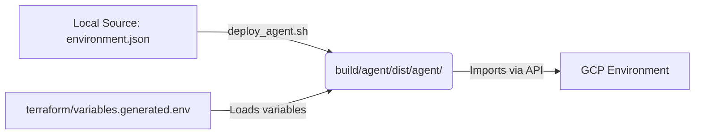

# CX Agent Studio Export Management: Comprehensive Guide and Best Practices

## Overview
This skill covers the complete folder structure, file schemas, configurations, and deployment commands required to successfully manage, modify, and deploy a CX Agent Studio Application. 

Conversational agents inside CX Agent Studio are developed locally in a declarative format (JSON, XML, and Python) and synchronized with Google Cloud Platform (GCP) via intermediate GCS buckets and administrative APIs. This guide details how to edit the agent export without causing schema validation errors or breaking environment integrations.

Key capabilities covered:
- **Export Folder Structure Map**: Understanding where every configuration lives.
- **Global App Configurations (`app.json`)**: Managing variables, speech parameters, timezone, and guardrail bindings.
- **Environment Mapping (`environment.json`)**: Linking generic tools to location-specific GCP resources.
- **Command-Line Lifecycle**: Zipping, validation, pushing/pulling changes, and environment placeholder replacement.
- **Evaluations and Test Cases**: Managing automated test cases (golden cases) and mock journeys.

> [!NOTE]
> This skill assumes the workspace is configured with Terraform for base infrastructure deployments, and utilizes the `agentutil` python CLI package for agent import/export integrations.

---

## Critical Rules (Always Apply)

> [!IMPORTANT]
> These rules override default assumptions. Adhere strictly to these constraints when modifying any agent exports.

- **Preserve Folder Layout:** Never flatten the export folder structure. The platform expects exact directory names: `agents/`, `tools/`, `guardrails/`, `app.json`, and `environment.json` must remain in their respective locations.
- **No Hardcoded Environments:** Do NOT hardcode GCP project IDs, region paths, or resource names in `app.json` or inside individual agent/tool definitions. Use placeholder names and let `environment.json` map them, or let `deploy_agent.sh` replace them dynamically using `terraform/variables.generated.env`.
- **Conflict Strategy:** When zipping and importing via the `importApp` API, always use the conflict resolution strategy `OVERWRITE` to ensure the remote workspace remains in perfect sync with the Git repository.
- **Verify References:** Before pushing, verify that all items in `app.json` lists (e.g., `guardrails` list) actually exist as JSON definitions under their corresponding directories.

> [!WARNING]
> Directly editing files in `./build/` is an anti-pattern. The build directory is ephemeral and is overwritten on every deploy run. Always edit source files in `data/agent/` or `data/data_store/`.

---

## Core Architecture / Data Model

### Directory Hierarchy Map
Below is the repository structure expected for a standard CX Agent Studio agent export:

```
data/agent/
├── app.json                                # Global application properties and variables
├── environment.json                        # Mappings from generic tools to GCP resources
├── agents/
│   └── <agent_id>/
│       ├── <agent_id>.json                 # Sub-agent metadata, tool list, and callbacks
│       ├── instruction.txt                 # Prompts and conversational task flows in XML
│       └── before_agent_callbacks/
│           └── before_agent_callbacks_01/
│               └── python_code.py          # Event detection or state prep script
├── tools/
│   ├── <datastore_tool_id>/
│   │   └── <datastore_tool_id>.json        # Vertex AI Search Data Store tool config
│   └── <python_tool_id>/
│       ├── <python_tool_id>.json           # Sandboxed Python tool definition
│       └── python_function/
│           └── python_code.py              # Sandboxed Python logic
├── evaluations/
│   └── <evaluation_id>/
│       └── <evaluation_id>.json            # Evaluation (golden case) turns definition
└── guardrails/
    └── <guardrail_id>/
        └── <guardrail_id>.json             # Model safety and security policy settings
```

### Global Configurations Schema (`app.json`)
The `app.json` file controls application-wide configurations:

| Key | Type | Description |
| :--- | :--- | :--- |
| `name` | `string` | The machine-readable ID of the application. |
| `displayName` | `string` | The human-readable display name on the GCP Console. |
| `rootAgent` | `string` | The ID of the primary agent entry point (usually `main`). |
| `variableDeclarations` | `array` | Global state variables accessible by all agents, callbacks, and tools. |
| `guardrails` | `array` | List of active guardrail policy names applied globally. |
| `languageSettings` | `object` | Configures the default language and enabled multilingual support languages. |
| `toolExecutionMode` | `string` | Controls tool calls scheduling (e.g., `PARALLEL` or `SEQUENTIAL`). |

---

## Quick Start / Minimum Viable Code

### 1. Minimal Global Application Setup (`app.json`)
This is the foundation file that must exist at `data/agent/app.json`:

```json
{
  "name": "my-conversational-agent",
  "displayName": "My Conversational Agent",
  "description": "CX Agent Studio virtual assistant",
  "rootAgent": "main",
  "audioProcessingConfig": {
    "synthesizeSpeechConfigs": {
      "en-US": {}
    }
  },
  "loggingSettings": {
    "cloudLoggingSettings": {
      "enableCloudLogging": true
    },
    "conversationLoggingSettings": {
      "retentionWindow": "31536000s"
    }
  },
  "guardrails": [
    "Safety Guardrail Default"
  ],
  "variableDeclarations": [
    {
      "name": "ui__brand_code",
      "description": "The brand code used to filter data stores.",
      "schema": {
        "type": "STRING",
        "default": "cymbal"
      }
    }
  ],
  "languageSettings": {
    "defaultLanguageCode": "en-US",
    "supportedLanguageCodes": [],
    "enableMultilingualSupport": false
  },
  "timeZoneSettings": {
    "timeZone": "America/Los_Angeles"
  },
  "toolExecutionMode": "PARALLEL"
}
```

### 2. Standard Environment Configuration (`environment.json`)
Maps environment-agnostic tools in your codebase to deployed GCP Cloud resources. This lives at `data/agent/environment.json`:

```json
{
  "tools": {
    "kb_data_store": {
      "dataStoreTool": {
        "engineSource": {
          "dataStoreSources": [
            {
              "dataStore": {
                "name": "projects/YOUR_PROJECT_ID/locations/YOUR_REGION/collections/default_collection/dataStores/YOUR_DATA_STORE_NAME"
              }
            }
          ]
        }
      }
    }
  },
  "toolsets": {
    "external_api_tool": {
      "openApiToolset": {
        "apiAuthentication": {
          "serviceAccountAuthConfig": {
            "serviceAccount": "your-service-account@your-project.iam.gserviceaccount.com"
          }
        }
      }
    }
  }
}
```

---

## Advanced Patterns & Best Practices

### 1. The Environment Replacement Pattern
To avoid tracking environment-specific secrets or hardcoded resource names in Git, use placeholders (`$KNOWLEDGE_BASE_DATA_STORE_NAME`) in files. The build pipeline uses Terraform-generated outputs to replace them during local builds before importing:



### 2. Adding a New Sub-Agent to the Export
When creating a new agent in the export:
1. Create the folder `data/agent/agents/my_new_agent/`.
2. Create `my_new_agent.json` mapping displayName and instruction path:
   ```json
   {
     "name": "my-new-agent",
     "displayName": "my_new_agent",
     "description": "Handles specialized user requests",
     "instruction": "agents/my_new_agent/instruction.txt",
     "tools": []
   }
   ```
3. Create the instruction text file `data/agent/agents/my_new_agent/instruction.txt`.
4. If other agents need to hand over to it, add `"my_new_agent"` to their metadata configurations if the platform requires child agent declarations.

---

## Bundled Scripts & Tool Logic

Local shell scripts automate zipping, variable replacement, and importing/exporting definitions from active cloud environments:

### 1. Pulling Remote Changes (GCP to Git)
Imports the current remote environment configurations and overwrites local source codes (make sure local modifications are committed first):
```bash
uv run scripts/pull_agent.sh
```

### 2. Deploying Local Changes (Git to GCP)
Prepares, replaces placeholders, zips, and uploads the local agent export to the active cloud workspace:
```bash
uv run scripts/deploy_agent.sh
```

### 3. Direct Command Invocation
Alternatively, run low-level commands via the `agentutil` CLI:
```bash
# Pulling agent
agentutil ces agent pull projects/PROJECT/locations/LOC/apps/APP_ID ./data/agent BUCKET_NAME

# Pushing agent
agentutil ces agent push ./build/agent/dist/agent/ projects/PROJECT/locations/LOC/apps/APP_ID BUCKET_NAME
```

---

## Documentation Lookup

- **Main Guide:** Refer to [GEMINI.md](../../../GEMINI.md) for repo workflows.
- **Evaluations Reference:** Check [evaluations.md](./references/evaluations.md) for test cases structure and mock journey configuration.
- **GCP Admin API Reference:** Check [importApp Specification](https://docs.cloud.google.com/customer-engagement-ai/conversational-agents/ps) for exact schema parameters of the importing payload.
