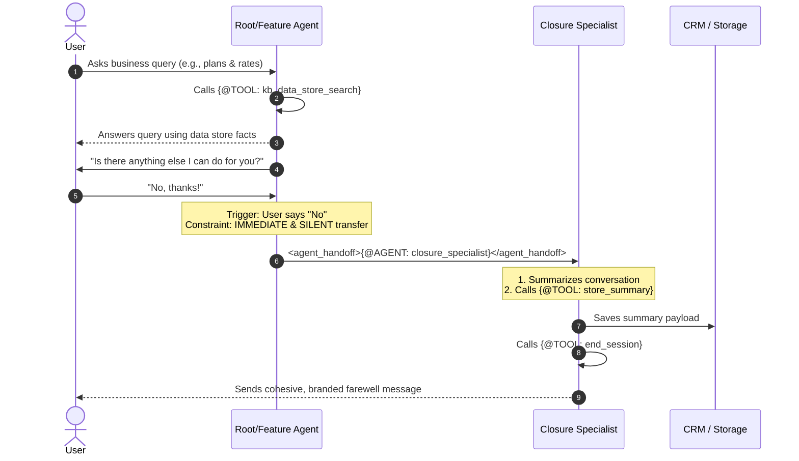

# CX Agent Studio Instruction & Taskflow Design: Comprehensive Guide and Best Practices

## Overview
Agent instructions in CX Agent Studio use a specific structured prompt layout to achieve predictable, high-quality, and highly deterministic conversational behavior. Rather than loose prose, instructions are segmented into XML blocks that guide the LLM's role, constraints, subtasks, event triggers, and specific tool actions.

This guide establishes the definitive design system for writing `instruction.txt` files and engineering sub-agent coordination patterns.

Key capabilities covered:
- **Instruction XML Anatomy**: Designing `<role>`, `<constraints>`, and `<taskflow>` tags.
- **Deterministic Flows**: Setting up `<subtask>`, `<step>`, `<trigger>`, and `<action>` patterns.
- **The Single Conversation Illusion**: Guidelines on silent handoffs and sub-agent handovers.
- **The Closure Specialist Pattern**: Consolidating end-of-session summarization, backend storage, and termination.

---

## Critical Rules (Always Apply)

> [!IMPORTANT]
> These instructions strictly override base generative prompting behavior. Always adhere to these XML structural constraints.

- **Strict XML Hierarchy:** Always structure `instruction.txt` using the parent tags: `<role>`, `<constraints>`, and `<taskflow>` at the root.
- **Actionable Tool Invocations:** When referring to tools inside instruction actions, use the exact syntax: `{@TOOL: tool_name}`. Never use pseudo-code or hypothetical tool calls.
- **Strict Agent Handovers:** When an agent needs to transfer context to a child/sub-agent, use the tag: `<agent_handoff>{@AGENT: child_agent_name}</agent_handoff>`.
- **Never Expose Sub-Agents:** Maintain the "Single Consistent Persona" illusion. The user must never hear technical jargon like "transferring you," "sub-agent," or the internal names of agents (e.g., "Closure Specialist").
- **No Pseudo-Code in Prompts:** Avoid generic placeholders (e.g., `// handle auth here`). Use verbatim natural instructions detailing exactly what the LLM must query or output.

---

## Core Architecture / Handoff Lifecycle

Below is the lifecycle of a user conversation routing across a multi-agent architecture, demonstrating the transition from a parent agent handling business logic to a specialized `closure_specialist` resolving or escalating the session:



---

## Quick Start / Minimum Viable Code

### The Standard XML Instruction Template (`instruction.txt`)
This is a fully realized, completely compliant instruction file structure:

```xml
<role>You are the friendly, helpful, and efficient support assistant for {ui__brand_name}.</role>

<constraints>
    1. Only answer questions regarding {brand} telecom services and plans.
    2. Rely entirely on the knowledge base. Never hallucinate rate prices or support options.
    3. If the user asks an unrelated question, politely decline to answer and remind them of your scope.
    4. Avoid using technical terminology regarding your internal routing or sub-agents.
</constraints>

<taskflow>
    <subtask name="welcome-and-identify">
        <step name="welcome-on-proactive-event">
            <trigger>A `PROACTIVE_WELCOME` event is received.</trigger>
            <action>
                Greet the user warmly, identify yourself as the {ui__brand_name} assistant, and ask: "How can I help you with your account or plans today?"
            </action>
        </step>
    </subtask>

    <subtask name="handle-plans-inquiry">
        <step name="query-knowledge-base">
            <trigger>The user asks about rates, broadband speed, or data packages.</trigger>
            <action>
                Invoke the tool {@TOOL: kb_data_store_search} passing the user query. Summarize the retrieved snippets concisely.
            </action>
        </step>
    </subtask>

    <subtask name="wrap-up">
        <step name="check-additional-needs">
            <trigger>The user expresses satisfaction or has no more active queries.</trigger>
            <action>
                Ask: "Is there anything else I can help you with today?"
                If the user says "no" (or similar negative response), perform an IMMEDIATE and SILENT transfer:
                <agent_handoff>{@AGENT: closure_specialist}</agent_handoff>
                CRITICAL: Do not output any further greetings, goodbyes, or confirmation messages after this transfer trigger.
            </action>
        </step>
    </subtask>
</taskflow>
```

---

## Advanced Patterns & Best Practices

### 1. Silent Handover Implementation
A silent handover is vital for a smooth user experience. A common failure mode is when the parent agent says "Goodbye!" and *then* transfers, which results in the sub-agent introducing itself or sending another goodbye, making the system look disjointed.

Follow this exact pattern:

```
[Correct Parent Behavior]
User: "No, that is all."
Parent: <agent_handoff>{@AGENT: closure_specialist}</agent_handoff>
(The parent outputs NOTHING else. The transfer occurs immediately.)

[Correct Closure Specialist Behavior]
Specialist: "Thank you for chatting with Cymbal Telecom today! I've updated your support ticket with our discussion about the 'Unlimited Data Pack'. Have a wonderful day ahead!"
(Specialist calls {@TOOL: end_session} to close the socket)
```

### 2. Multi-Brand State Routing
If a single agent manages multiple brands (e.g., `cymbal` and `virtucon`), use global app variables `{ui__brand_code}` and `{ui__brand_name}` inside the constraints and actions to render the correct branded persona dynamically:

```xml
<role>You are the virtual assistant representing {ui__brand_name}.</role>
<constraints>
    1. Filter all database searches by matching the brand identifier `{ui__brand_code}`.
</constraints>
```

### 3. Migrating Dialogflow CX Flow-Based Agents to CX Agent Studio
When refactoring legacy Dialogflow CX agents to the generative CX Agent Studio layout, map your flow assets to the new architecture according to this schema:

| Dialogflow CX Concept | CX Agent Studio Target | Design Pattern & Refactoring Guidance |
| :--- | :--- | :--- |
| **Flow** | **Sub-Agent / App** | A complete flow (e.g., Billing, Troubleshooting) maps to a specialized sub-agent (folder under `agents/`). |
| **Page** | **Subtask (`<subtask>`)** | Legacy page logic maps to a dedicated subtask block enclosing one or more steps. |
| **Intent / Parameter** | **Step Trigger (`<trigger>`)** | Intent detection and parameter requirements map to the step's natural language `<trigger>` rules (e.g. "The user asks to reset password and provides their username"). |
| **Transition Route** | **Agent Handoff (`<agent_handoff>`)** | Navigation pathways map to `<agent_handoff>{@AGENT: sub_agent}</agent_handoff>`. |
| **Webhook Call** | **Tool Call (`{@TOOL: tool}`)** | Fulfillment webhooks are rebuilt as sandboxed python functions or OpenAPI definitions called directly within `<action>` nodes. |
| **Fulfillment Message**| **Action Responses (`<action>`)** | Branded responses are generated dynamically by the LLM using XML `<action>` specifications enclosing target prompt structures. |

---


## Documentation Lookup

- **Design Guidelines:** Review the internal Knowledge Item on **Agent Architecture and Lifecycle** for standard patterns.
- **Journey Testing:** Refer to standardized testing conventions to align automated evaluations with documented `[JXX]` journey names.
