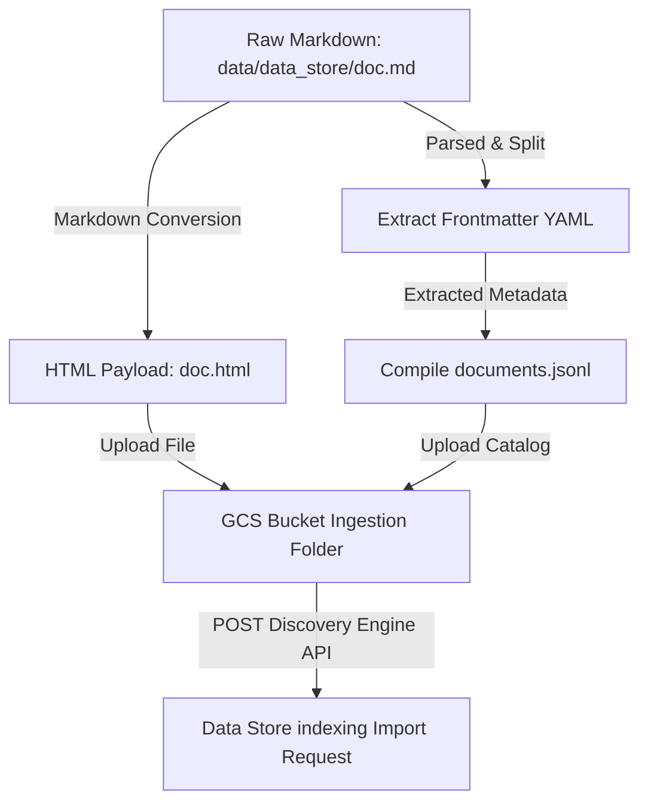

# CX Agent Studio Knowledge Base Ingestion: Comprehensive Guide and Best Practices

## Overview
CX Agent Studio integrates with Vertex AI Search (VAIS) / Discovery Engine to provide Retrieval-Augmented Generation (RAG) capabilities. Raw domain knowledge is authored locally as Markdown documents (`.md`) under the `data/data_store/` folder, processed into compliant HTML content, and cataloged inside a JSONL manifest before being ingested into the Discovery Engine Data Store.

This skill details the file preparation rules, manifest schemas, and ingestion execution workflows.

Key capabilities covered:
- **Document Formatting Guidelines**: Structuring frontmatter metadata fields.
- **Markdown-to-HTML Processing**: Understanding manifest conversion.
- **Discovery Engine JSONL Catalog Schema**: Formulating the compilation entries.
- **GCS Upload & API Ingestion Commands**: Executing local imports dynamically.

---

## Critical Rules (Always Apply)

> [!IMPORTANT]
> Discovery Engine ingestion will reject files that fail schema metadata matching or are processed with invalid manifest links.

- **YAML Frontmatter is Mandatory:** Every Markdown file in `data/data_store/` must begin with a standard YAML frontmatter block enclosing a `title` and a nested `metadata` dictionary.
- **Brand Codes Match Constraints:** The `brand_code` defined in the frontmatter metadata block must match the global brand variables (e.g. `cymbal`) used by the routing agents to ensure documents filter correctly during search tool executions.
- **Single JSONL Manifest Entry per Document:** The `documents.jsonl` manifest must represent each HTML document as an individual JSON line containing the `id`, `structData` (extracted metadata), and `content` (GCS URI location).
- **Ensure GCS URI Alignment:** The URI references inside `documents.jsonl` must point to the *final destination bucket folder location* in Google Cloud Storage (e.g. `gs://YOUR-BUCKET/data_store/ingestion/doc.html`).

---

## Ingestion Flow Pipeline

The local Markdown files are preprocessed, cataloged, uploaded, and indexed using the following sequence:



---

## Quick Start / Minimum Viable Code

### 1. Properly Formatted Markdown Knowledge Document (`data_store/doc.md`)
Create your source documents at `data/data_store/my-brand-plans.md`:

```yaml
---
title: "Cymbal Telecom Unlimited Data Plans"
version: 1.0
metadata:
    brand_code: "cymbal"
    brand_name: "Cymbal Telecom"
    category: "mobile_data"
---

# Premium Unlimited Offerings
Cymbal Telecom offers two tiers of high-speed, reliable unlimited cellular data packages designed for power users and remote professionals.

## 1. Cymbal Unlimited Plus
- **Price:** $55/month per single line.
- **Speeds:** Uncapped 5G speeds up to 400 Mbps.
- **Hotspot Allocation:** Includes 20 GB of high-speed mobile hotspot allocation per billing cycle (throttled to 3G speeds afterwards).

## 2. Cymbal Unlimited Ultimate
- **Price:** $70/month per single line.
- **Speeds:** Uncapped 5G speeds with priority routing on crowded towers.
- **Hotspot Allocation:** Includes 50 GB of high-speed mobile hotspot allocation.
- **Bonus:** Includes standard subscription to Cymbal Stream TV streaming service.
```

### 2. Generated Discovery Engine Manifest Entry (`documents.jsonl`)
During processing, the `agentutil` parser compiles raw Markdown files into a unified `.jsonl` file. Each line represents a document:

```json
{"id": "my-brand-plans", "structData": {"title": "Cymbal Telecom Unlimited Data Plans", "brand_code": "cymbal", "brand_name": "Cymbal Telecom", "category": "mobile_data"}, "content": {"mimeType": "text/html", "uri": "gs://tf-dev-ces-blueprint-build/agent-app-id/data_store/ingestion/my-brand-plans.html"}}
```

---

## Bundled Scripts & Tool Ingestion Calls

You can run document compilation and data store indexing automatically or programmatically:

### 1. Run Ingestion via Build Script
The easiest method is to invoke the standard build script with the `--ingest-kb` argument. This triggers Terraform environment loading, processes the Markdown files in `data/data_store`, uploads HTML and manifests to GCS, and submits the import operation to the Active Data Store:

```bash
uv run scripts/deploy_agent.sh --ingest-kb
```

### 2. Process and Ingest via agentutil CLI
Alternatively, invoke the `agentutil` CLI commands directly to run custom folders:

```bash
# Compile Markdown and Upload/Ingest into Target Data Store
agentutil data-store ingest \
    ./data/data_store \
    ./build/data_store \
    gs://YOUR-BUILD-BUCKET/agent-app-id/data_store/ingestion/ \
    --ingest-to "projects/YOUR_PROJECT_ID/locations/YOUR_REGION/collections/default_collection/dataStores/YOUR_DATA_STORE_NAME"
```

---

## Discovery Engine API Reference

Under the hood, the CLI submits a POST request to the location-specific Discovery Engine endpoint to trigger indexing:

### 1. Request Target Endpoint
- **Global Collections Location:** `https://discoveryengine.googleapis.com/v1/projects/{project}/locations/{location}/collections/{collection}/dataStores/{dataStore}/branches/0/documents:import`
- **Regional collections Location (e.g. `eu`):** `https://eu-discoveryengine.googleapis.com/v1/projects/{project}/locations/eu/collections/default_collection/dataStores/{dataStore}/branches/0/documents:import`

### 2. Ingestion POST Request Payload
The headers require `Authorization: Bearer $(gcloud auth print-access-token)` and `Content-Type: application/json`.

```json
{
  "gcsSource": {
    "inputUris": [
      "gs://YOUR-BUILD-BUCKET/agent-app-id/data_store/ingestion/documents.jsonl"
    ],
    "dataSchema": "document"
  },
  "reconciliationMode": "FULL"
}
```
> [!TIP]
> Setting `reconciliationMode` to `FULL` acts as a clean reconciliation: any document previously imported in the data store but missing from the new `documents.jsonl` manifest catalog is automatically deleted from the index, keeping your searchable catalog perfectly clean.

---

## Advanced Ingest: Translating Meeting Recordings / Transcripts to Agent Architectures

When you are given a customer support meeting recording or transcript and tasked with implementing or extending a virtual agent based on it:

### Phase 1: Knowledge Base Synthesis
1. **Analyze Transcript for Factual Content:** Extract core procedures, troubleshooting steps, service packages, pricing lists, and guidelines discussed in the transcript.
2. **Author Clean Markdown Documents:** For each distinct domain topic (e.g., "How to handle billing disputes"), create a separate Markdown file under `data/data_store/` following the frontmatter structure:
   ```yaml
   ---
   title: "Troubleshooting Guide: Service Outages"
   metadata:
       brand_code: "cymbal"
       brand_name: "Cymbal Telecom"
       category: "troubleshooting"
   ---
   # Outage Escalation Procedures
   ...
   ```
3. **Reconcile Ingest:** Run `uv run scripts/deploy_agent.sh --ingest-kb` to build the HTML payloads, compile `documents.jsonl`, and index the documents into the search engine.

### Phase 2: XML Taskflow Engineering
1. **Identify Conversational Pathways:** Map conversational phases discussed in the recording to structured `<subtask>` groupings.
2. **Define Triggers and Actions:** For every support agent query or response event in the transcript:
   - Model the user message as a natural language trigger (`<trigger>`).
   - Model the agent's response or logic as an actionable step (`<action>`).
   - Reference the ingested RAG search tools when needed: `{@TOOL: kb_data_store_search}`.
   - Reference the new skills layout if adding specific domain documentation.
3. **Structure inside `instruction.txt`:** Write the newly synthesized taskflows directly into the specialized agent's XML prompt instructions.
