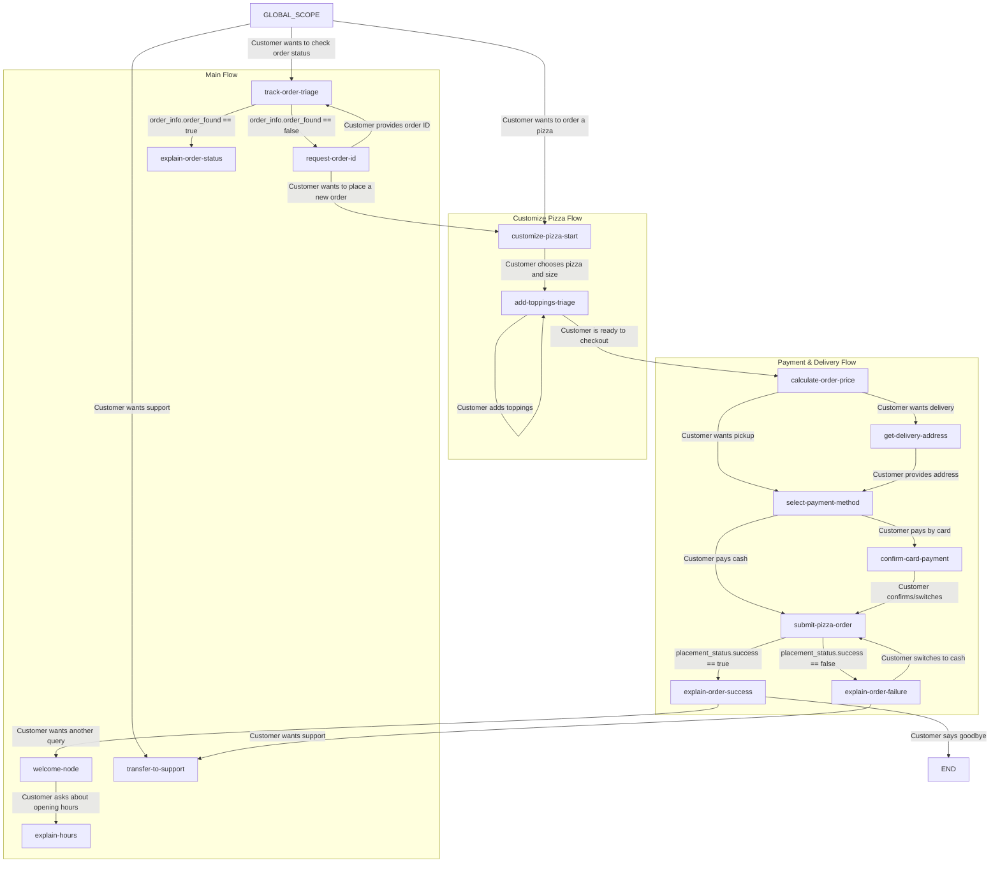

# Pizza Ordering SOP Example

This document explains the structure and design of the Pizza Ordering SOP located in `example_sops/pizza-order-flow`. It demonstrates a fully-compliant SOP Version 2 workspace configuration, utilizing typed variables, conditional routing, actions with mock response journeys, and sub-flows.

## Project Structure

The project is structured under the `example_sops/pizza-order-flow/` directory and contains three files:
1. [main.yml](../example_sops/pizza-order-flow/main.yml): The entry point for the SOP, defining global instructions, global intent routes, triage nodes, and order tracking.
2. [customize-pizza-flow.yml](../example_sops/pizza-order-flow/customize-pizza-flow.yml): A sub-flow dedicated to selecting pizza type, size, and adding optional toppings.
3. [payment-delivery-flow.yml](../example_sops/pizza-order-flow/payment-delivery-flow.yml): A sub-flow for calculating the total price, collecting delivery details, selecting payment methods, and submitting the order.

---

## SOP Visualizer Graph Mapping

Below is a representation of the conversation flow and transitions between nodes:

---

## Detailed Node Implementations

### 1. Global Setup (`main.yml`)
- **Global Intent Routes**: Configured to capture triage requests (e.g. order a new pizza, track status, talk to support) at any conversational step, preventing the need to duplicate these routes within individual sub-flows.
- **Input Variables**: Predefines `session_customer_phone` and `order_id` with default values to enable immediate testing out of the box.

### 2. Customizing Pizzas (`customize-pizza-flow.yml`)
- **Actions**: Calls `get_pizza_menu` to retrieve the current menu options and pricing.
- **Strict Typing (SOP V2)**: Extracted selections use strict enum constraints to ensure consistent downstream processing:
  - `chosen_pizza`: `enum[margherita,pepperoni,veggie_supreme]`
  - `chosen_size`: `enum[small,medium,large]`
- **Design Review Request**: Includes an embedded review request (`id: rev-cust-01`, topic `DESIGN`) to gather feedback from the UX design team regarding the toppings collection loop.

### 3. Payment & Delivery Triage (`payment-delivery-flow.yml`)
- **Total Calculation**: Sequentially runs `calculate_total_price` passing the parameters from the previous flow.
- **Conditional Branching**: The execution engine programmatically routes based on variables like `order_type`, `payment_method`, and the API response (`placement_status.success`).
- **Technical Review Request**: Contains a technical review request (`id: rev-pay-01`, topic `TECHNICAL`) to ensure proper error handling and prevent double-charging on API timeouts.
