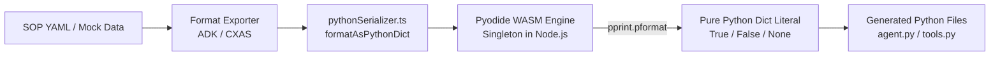

# Implementation Plan - WASM Python Literal Serialization for ADK & CXAS Exports

## Goal Description
In ADK (Agent Development Kit) and CXAS (CX Agent Studio) exports, JSON structures are currently embedded into generated Python files using JSON strings and runtime parsing:
1. **Mock responses in Python tools**: `mock_responses = json.loads(r'''{...}''')`
2. **SOP graph specification in Graph-Guided start flows**: `FLOW_SPEC = json.loads(base64.b64decode(...))` or `json.loads(FLOW_SPEC_JSON)`

The goal is to convert these JSON data structures into **pure, native Python dictionary literals** (`FLOW_SPEC = { ... }`, `mock_responses = { ... }`, `True`, `False`, `None`) directly during the export phase using an in-memory **WebAssembly Python engine (Pyodide)**. This produces cleaner, more elegant, and idiomatic Python code, removes unnecessary runtime imports (`import json`, `import base64`), and guarantees 100% syntactical compliance with Python's official AST and `pprint` formatting without subprocess latency.

---

## User Review Required

> [!IMPORTANT]
> **WASM Python Runtime**: We will use `pyodide` (`npm install pyodide`), which runs standard CPython 3.12 compiled to WebAssembly. A singleton Pyodide instance is initialized on server startup / first export, keeping execution latency under 1ms per serialization while eliminating all host `python3` OS binary dependencies.

> [!NOTE]
> **Indentation Alignment**: Python requires strict 4-space block indentation inside functions. The serializer will support a `baseIndent` option (e.g. 4 spaces for tool mock responses) so that multi-line dictionary literals cleanly align with their enclosing Python function bodies.

---

## Technical Architecture



---

## Proposed Changes

### Core Serialization Module

#### [NEW] [src/core/formats/pythonSerializer.ts](../src/core/formats/pythonSerializer.ts)
- Manages the singleton Pyodide WebAssembly runtime in Node.js.
- Exposes `formatAsPythonDict(data: unknown, options?: PythonDictOptions): Promise<string>`.
- Executes Python's native `pprint.pformat(obj, indent=..., sort_dicts=False)` inside the in-memory WASM VM.
- Applies `baseIndent` offsetting so formatted multi-line literals match the indentation depth of Python functions or top-level assignments.

```typescript
export interface PythonDictOptions {
  indent?: number;      // Spaces per indentation level (default: 4)
  baseIndent?: number;  // Base indentation offset in spaces (default: 0)
  width?: number;       // Max line width for pprint (default: 100)
}

export async function formatAsPythonDict(
  data: unknown,
  options: PythonDictOptions = {}
): Promise<string> {
  const { indent = 4, baseIndent = 0, width = 100 } = options;
  const pyodide = await getPyodideInstance();
  
  pyodide.globals.set('__raw_json__', JSON.stringify(data));
  const rawPythonCode: string = pyodide.runPython(`
import json, pprint
data = json.loads(__raw_json__)
pprint.pformat(data, indent=${indent}, sort_dicts=False, width=${width})
`);

  if (baseIndent === 0) {
    return rawPythonCode;
  }

  const padding = ' '.repeat(baseIndent);
  return rawPythonCode
    .split('\n')
    .map((line, idx) => (idx === 0 ? line : padding + line))
    .join('\n');
}
```

---

### ADK Export Formatting

#### [MODIFY] [src/core/formats/adk.ts](../src/core/formats/adk.ts)
1. **Tool Mock Responses**:
   - In both Graph-Guided and Fully Agentic modes, format `toolData.mockResponses` via `await formatAsPythonDict(toolData.mockResponses, { indent: 4, baseIndent: 4 })`.
   - Replace `mock_responses = json.loads(r'''...''')` with `mock_responses = ${formattedMocks}`.
2. **Graph-Guided Start Flow**:
   - Format `strippedSop` via `await formatAsPythonDict(strippedSop, { indent: 4, baseIndent: 0 })`.
   - Replace `FLOW_SPEC_B64 = ...` and `FLOW_SPEC = json.loads(...)` with `FLOW_SPEC = ${formattedFlowSpec}`.
3. **Unused Imports**:
   - Remove `import json` and `import base64` from generated tool code and start flow script.

---

### CXAS Export Formatting

#### [MODIFY] [src/core/formats/cxas/tools.ts](../src/core/formats/cxas/tools.ts)
1. Convert `generateTools` to an `async` function.
2. Format `toolData.mockResponses` via `await formatAsPythonDict(toolData.mockResponses, { indent: 4, baseIndent: 4 })`.
3. Replace `mock_responses = json.loads(...)` with `mock_responses = ${formattedMocks}`.
4. Remove `import json` from `tools/${toolFolderName}/python_function/python_code.py`.

#### [MODIFY] [src/core/formats/cxas/graphGuided.ts](../src/core/formats/cxas/graphGuided.ts)
1. Convert `exportGraphGuided` to `async` (and update callers in `src/core/formats/cxas/index.ts`).
2. Format `strippedSopSpec` via `await formatAsPythonDict(strippedSopSpec, { indent: 4, baseIndent: 0 })`.
3. Replace `FLOW_SPEC_JSON = ...` and `FLOW_SPEC = json.loads(...)` with `FLOW_SPEC = ${formattedFlowSpec}`.
4. Remove `import json` from generated `startToolPythonCode`.

---

### Dependencies & Build System

#### [MODIFY] [package.json](../package.json)
- Add `"pyodide": "^0.26.4"` to `dependencies`.

---

## Verification Plan

### Automated Tests
1. **Serializer Unit Tests**:
   - Create `tests/python_serializer.test.ts` to test:
     * Primitives: `true` $\rightarrow$ `True`, `false` $\rightarrow$ `False`, `null` $\rightarrow$ `None`.
     * Numbers: Integers, floats, negative numbers, scientific notation.
     * Strings: Escapes, quotes, unicode accents, emojis (e.g. `🍕`).
     * Indentation: Proper `baseIndent` alignment.
     * Round-trip AST equality: Serialized literal parses identically to original JSON.
2. **Export Agent Integration Tests**:
   - Update `tests/export_agent.test.ts` to assert that exported ADK `agent.py` and CXAS tool files:
     * Contain pure dictionary literals (`mock_responses = { ... }`, `FLOW_SPEC = { ... }`).
     * Contain **no** `json.loads` or `FLOW_SPEC_B64`.
     * Parse cleanly without any Python syntax or indentation errors.

```bash
npm test
```

### Manual Verification
1. Run ASOP Studio dev server (`npm run dev`).
2. Export `pizza-order-flow` as ADK package (both Fully Agentic and Graph-Guided).
3. Inspect `agent.py` in the exported ZIP archive to confirm pure Python dictionaries and clean formatting.
4. Export `pizza-order-flow` as CXAS blueprint and verify generated tools under `tools/*/python_function/python_code.py`.
