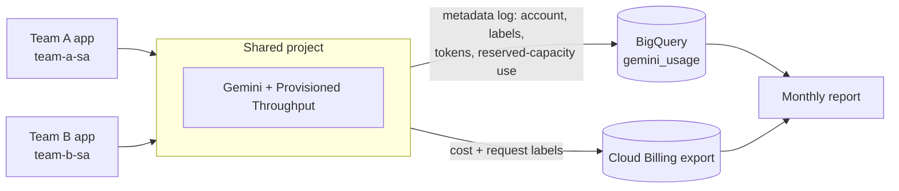
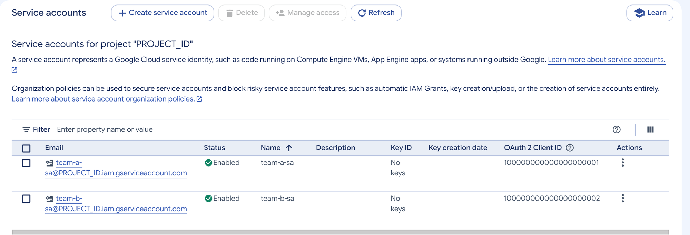
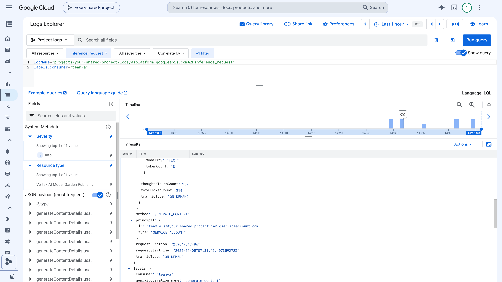
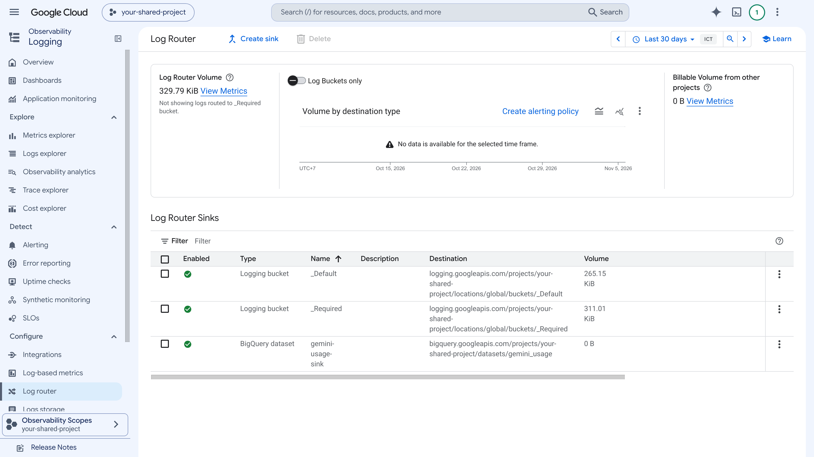
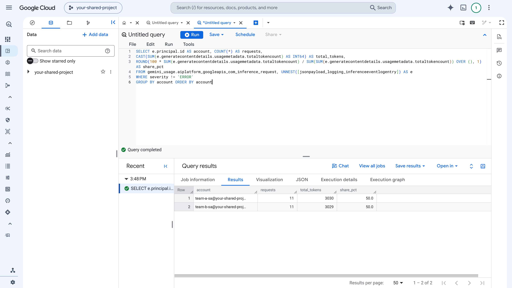
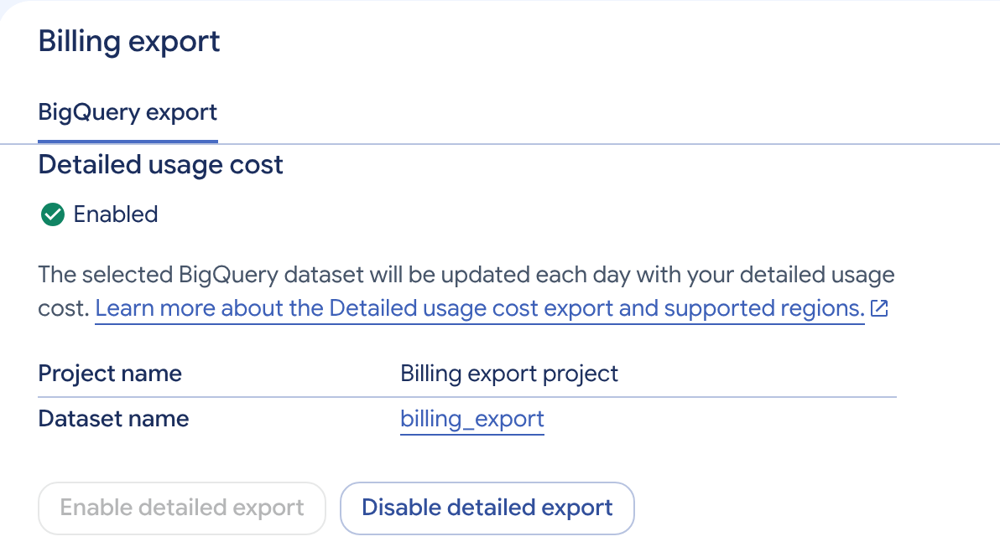
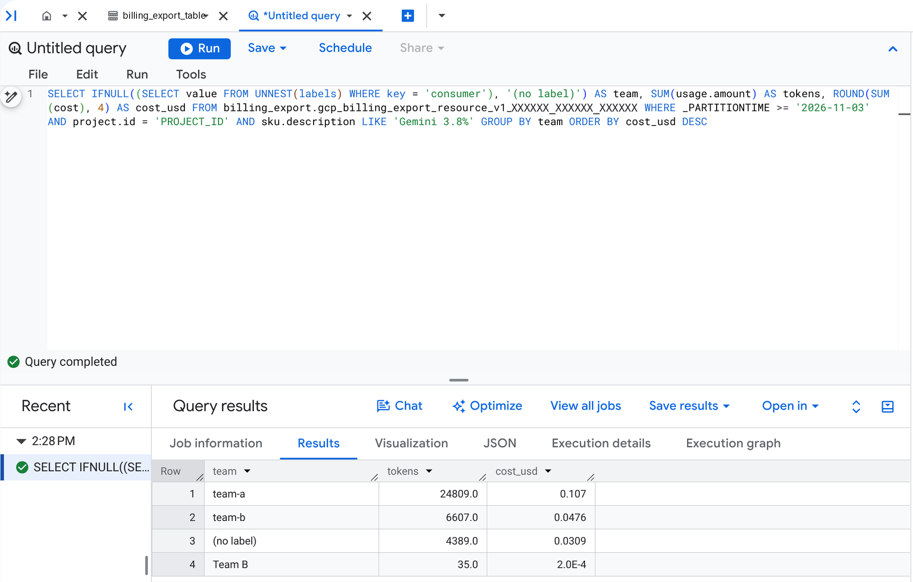

# Gemini usage and cost tracking per team on shared Provisioned Throughput

A working sample for platform and FinOps teams that need to answer one question:
**which team used our Gemini capacity, and how do we share the cost fairly?**

It covers Gemini on Vertex AI (Agent Platform) when several teams share one Google Cloud project. This is the usual
setup with **Provisioned Throughput**, because an order and its fixed fee belong to a single project.

> This is not an officially supported Google product. Use it as a starting point and review it against your own policies.

## The problem

By default, Cloud Billing shows Gemini cost **per project and per usage type** (model, input or output tokens,
the Provisioned Throughput fee). When two or more teams share a project, the bill alone cannot tell you who used what.

| Tracking level | What you can split by | How |
|---|---|---|
| 1. Project (default) | Project, model, input vs output | Cloud Billing export |
| 2. Account identity | Each calling service account, per request, with token counts and reserved-capacity use | One service account per team + inference request metadata logs |
| 3. Business detail | Any field: team, app, feature, cost center | Request labels (reach the bill) or header labels (log only) |
| 4. Enforced | Every request, with labels added and unknown callers blocked | An API gateway in front of Gemini |

This sample uses **level 2 as the basis of the split** and **level 3 for extra detail**, because labels are set by the
caller and can be missing or misspelled. Level 4 is described in [docs/api-gateway-pattern.md](docs/api-gateway-pattern.md).

## How it works



- **[Inference request metadata logs](https://docs.cloud.google.com/gemini-enterprise-agent-platform/models/capabilities/inference-metadata-logging)**
  write one entry per Gemini request: the calling account, model, traffic type (`PROVISIONED_THROUGHPUT` or `ON_DEMAND`),
  token counts, the Provisioned Throughput burndown, and any labels. They **never record prompts or responses**, and one
  project-wide setting covers every model. A log sink copies them to BigQuery.
- **Fixed fee:** split by each team's share of the Provisioned Throughput burndown (`ptChargedInputTokenCount` and
  `ptChargedOutputTokenCount`), which already reflects the different rates for input, output, cached and thinking tokens.
- **Overflow usage:** usage above the reservation is billed at pay-as-you-go prices. Charge each team its actual cost from
  the billing export, using request labels. Token share is not cost share, because prices differ by model and token type.

## What's in this repository

| Path | What it is |
|---|---|
| [`scripts/`](scripts/) | `01_setup.sh` (safe to rerun), `02_send_sample_requests.sh`, `03_check_usage.sh`, `99_cleanup.sh` |
| [`terraform/`](terraform/) | Optional module: team service accounts, IAM, metadata logs, dataset, log sink |
| [`sql/`](sql/) | Reusable queries: usage per account, reserved vs pay-as-you-go, usage per label, failed requests, monthly allocation, cost per label, unlabeled cost, label typos |
| [`notebooks/`](notebooks/) | `gemini_cost_attribution.ipynb`: sends requests as each team and builds the report with the Google Gen AI SDK |
| [`docs/`](docs/) | Allocation models, Provisioned Throughput guide, billing export behavior, gateway pattern, troubleshooting |
| [`tests/`](tests/) | `run_tests.sh`: offline unit tests for `common.sh`, SQL template rendering, Terraform defaults, notebook hygiene, and ID checks |

## Before you start

- A Google Cloud project where your teams call Gemini. Provisioned Throughput is optional: everything here works with pay-as-you-go traffic, and the reports separate reserved traffic once you have an order.
- The Google Cloud CLI (`gcloud`, `bq`), `curl`, `jq` and `envsubst` (Cloud Shell has all of them). Terraform 1.5 or later if you use the module.
- Roles on the project: Project IAM Admin, Service Account Admin, BigQuery Admin, Logs Configuration Writer and Vertex AI Administrator (or Owner).
- Optional: [Cloud Billing export to BigQuery](https://docs.cloud.google.com/billing/docs/how-to/export-data-bigquery-setup) with **detailed usage cost** turned on. You need it for the cost (not token) view.

## Quick start (scripts)

```bash
git clone https://github.com/GoogleCloudPlatform/professional-services.git
cd professional-services/examples/provisioned-throughput-cost-tracking/scripts
cp config.env.example config.env     # set PROJECT_ID, CALLER_MEMBER and (optionally) BILLING_TABLE
bash 01_setup.sh                     # safe to run more than once
sleep 180                            # a new log sink takes a few minutes to start copying
bash 02_send_sample_requests.sh 2    # 2 rounds per team: request label, header label, no label
sleep 180 && bash 03_check_usage.sh  # rows usually arrive within a few minutes
```

`01_setup.sh` does six things, and each one prints `ok` when it is done:

1. Turns on the Vertex AI, BigQuery and Logging APIs.
2. Creates one service account per team (`team-a-sa`, `team-b-sa`).
3. Grants each account `roles/aiplatform.user`, and lets `CALLER_MEMBER` impersonate them for the sample requests.
4. Creates the `gemini_usage` BigQuery dataset.
5. Turns on inference request metadata logs for every model in the project.
6. Creates a log sink that copies those logs into the dataset. The sink creates the table
   `aiplatform_googleapis_com_inference_request` when it copies the first entry.

Set `PROMPT_LOGGING="true"` in `config.env` only if you also want full prompts and responses in BigQuery.
Cost tracking does not need them.

`02_send_sample_requests.sh` prints one line per request:

```text
team    labels                  total_tokens  traffic_type
team-a  {"consumer": "team-a"}  311           ON_DEMAND
team-a  header                  296           ON_DEMAND
team-a  none                    311           ON_DEMAND
```

`total_tokens` includes thinking tokens, which are billed at the output rate. `traffic_type` reads
`PROVISIONED_THROUGHPUT` for requests served by your reservation. See
[what changes with Provisioned Throughput](#what-changes-when-provisioned-throughput-is-active).

`03_check_usage.sh` runs the queries in [`sql/`](sql/). The usage reports come from the metadata log:

```text
account                                                 requests  input_tokens  output_tokens  thinking_tokens  total_tokens  share_pct
team-a-sa@your-shared-project.iam.gserviceaccount.com          6           98             61             1694          1853       50.2
team-b-sa@your-shared-project.iam.gserviceaccount.com          6           98             58             1680          1836       49.8
```

The cost reports come from the billing export. New usage can take about a day and a half to appear there,
so run the script again the next day.

## Quick start (Terraform, optional)

The [`terraform/`](terraform/) module creates the same resources as `01_setup.sh`. Use one or the other for a project, not both.

```bash
cd terraform
cp terraform.tfvars.example terraform.tfvars   # set project_id, teams, caller_members
terraform init
terraform apply
```

Then send requests with `scripts/02_send_sample_requests.sh` (or your own applications) and run `scripts/03_check_usage.sh`.

Things to consider:

- There is no Terraform resource for the metadata log setting yet. The module calls the `setPublisherModelConfig` API with
  `curl`, so the machine running Terraform needs `curl` and `gcloud`. Set `enable_metadata_logging = false` to skip it.
- The dataset uses a default expiry of `log_retention_days` (400 days by default), so a full year of history is kept for audits.
- `terraform destroy` keeps the dataset if it still holds logs, to protect your usage history. Set `delete_contents_on_destroy = true` if you want destroy to delete the logs too.

## What you will see

| Step | Screenshot |
|---|---|
| One service account per team |  |
| A metadata log entry: calling account, labels, traffic type and tokens, with no prompt |  |
| Log sink copying the metadata log to BigQuery |  |
| Tokens per account from the metadata log in BigQuery |  |
| Billing export with detailed usage cost |  |
| Cost per team label from the billing export |  |

## What changes when Provisioned Throughput is active

The screenshots above come from a project that uses pay-as-you-go traffic. When your project has an active
Provisioned Throughput order, check for these extra signs. The full checklist is in
[docs/provisioned-throughput.md](docs/provisioned-throughput.md).

- **Responses:** `usageMetadata.trafficType` reads `PROVISIONED_THROUGHPUT` for requests served by your reservation and
  `ON_DEMAND` for overflow usage.
- **Metadata log:** entries for reserved traffic carry a `provisionedThroughput` object with `ptChargedInputTokenCount`,
  `ptChargedOutputTokenCount` and `accountingResource`. `usage_by_account_and_traffic_type.sql` shows them as
  `pt_charged_tokens`, and `monthly_allocation.sql` splits the fee by them.
- **Cloud Monitoring:** the Provisioned Throughput page and the Model Garden monitoring dashboard show how full the
  reservation is.
- **Billing export:** the fixed fee appears as its own line with no team labels, because labels on requests do not apply to
  the subscription fee. Overflow usage appears as normal Gemini lines and keeps the request labels.

## Best practices

1. **Give each cost center its own identity.** One service account (or workload identity) per team or application makes the
   metadata log the source of truth, with no extra code.
2. **Add request labels for the invoice view.** Labels in the request body (`consumer=team-a`) carry through to the billing
   export, so finance can see overflow cost per team next to other cloud costs. Header labels are useful for extra detail
   (app, feature) that you only need in the log.
3. **Agree a written cost-sharing policy first.** Decide whether the fixed fee is split by actual use, by an agreed ratio, or
   as a baseline plus overflow. See [docs/allocation-models.md](docs/allocation-models.md).
4. **Run a monthly check.** Look for unlabeled cost (`unattributed_cost.sql`) and label typos (`label_validation.sql`).
   Aim to keep unlabeled cost under about 2%, and alert on it daily if you can.
5. **Log metadata, not content.** The metadata log is enough for cost sharing and never stores prompts. Turn on prompt and
   response logging only for a clear reason, and limit who can read it.
6. **Keep a year of history.** The Cloud Logging default retention is 30 days. The BigQuery copy in this sample keeps
   400 days, so you can answer audit questions about last year's split.
7. **Cover every project.** If teams use several projects, an
   [aggregated sink](https://docs.cloud.google.com/logging/docs/export/aggregated_sinks) at folder or organization level
   can collect every project's metadata log into one dataset.
8. **Right-size the reservation.** Compare reserved use with the order each month. Persistent overflow usage or 429
   errors (`rejected_requests.sql`) suggest more capacity, and persistent idle capacity suggests less.
9. **Share before you charge.** Start with a monthly report that teams can see (showback) before moving to internal cost
   sharing with real budget transfers (chargeback).

## Related resources

- [Log inference request metadata](https://docs.cloud.google.com/gemini-enterprise-agent-platform/models/capabilities/inference-metadata-logging)
- [Add custom metadata labels to API calls](https://docs.cloud.google.com/gemini-enterprise-agent-platform/models/capabilities/add-labels-to-api-calls)
- [Provisioned Throughput overview](https://docs.cloud.google.com/gemini-enterprise-agent-platform/models/provisioned-throughput)
- [Export Cloud Billing data to BigQuery](https://docs.cloud.google.com/billing/docs/how-to/export-data-bigquery)
- [Log requests and responses](https://docs.cloud.google.com/gemini-enterprise-agent-platform/models/capabilities/request-response-logging), if you also need content
- [Apigee samples](https://github.com/GoogleCloudPlatform/apigee-samples) (`llm-token-limits`), for a gateway that enforces per-team quotas
- [FinOps for AI](https://www.finops.org/topic/ai-value/) from the FinOps Foundation

## Testing

```bash
bash tests/run_tests.sh
```

## Clean up

```bash
bash scripts/99_cleanup.sh   # or: cd terraform && terraform destroy
```

This turns off the metadata log setting and removes the sink, dataset, role grants and team service accounts. It does not
change your billing export or any Provisioned Throughput order.

## Disclaimer

This is a sample, not an officially supported Google product. Prices, fees and figures in this repository are illustrative.
Check your own contract and invoice for the name of the Provisioned Throughput fee line and its amount.

## License

[Apache 2.0](../../LICENSE)
