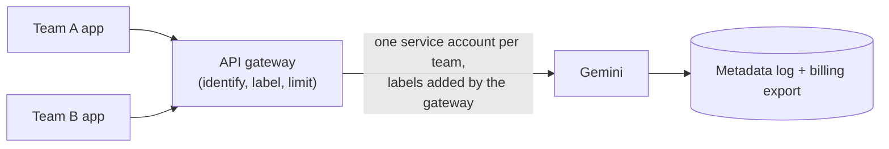

# Enforcing attribution with an API gateway

Service accounts and labels rely on each team's application to behave. When many teams or applications share
Gemini, or when you need hard per-team limits, put an API gateway in front of the Gemini API.

## What a gateway adds

| Need | Without a gateway | With a gateway |
|---|---|---|
| Know who called | One service account per team | The gateway identifies the caller (API key, OAuth client, mTLS) |
| Labels on every request | Each team adds them | The gateway adds `consumer` and other labels itself, so none are missing or misspelled |
| Per-team limits | Not possible inside one project | Token quotas and rate limits per team |
| Block unknown callers | IAM only | Only registered consumers can reach Gemini |

## How it fits with this sample

- Keep one service account per team **behind** the gateway, so the metadata log still attributes each request.
- Let the gateway set request labels (`consumer`, `app`, `cost_center`) so the billing export is always complete.
- Use gateway token quotas for each team's share of the reservation, and allow controlled overflow usage above it. This
  is how the "baseline plus overflow" model in [allocation-models.md](allocation-models.md) is usually enforced.

## Starting points

- [Apigee samples](https://github.com/GoogleCloudPlatform/apigee-samples): the `llm-token-limits` samples show
  per-consumer token quotas and prompt size limits for Gemini.
- Any gateway that can add headers or rewrite the request body can do the labelling. Header labels
  (`x-goog-agent-platform-observability-label-<key>`) are the simplest to add, but they only reach the metadata log.
  To reach the billing export, the gateway must add `labels` to the request body.
